# Web Ofisi Mobile

**English** | [Türkçe](README.tr.md)

A Flutter e-commerce app for selling ready-made web software (scripts) and hosting packages, developed solo as a 30-day internship project. It lists 158 web scripts from an XML feed and handles user accounts, favorites, cart, checkout and support tickets through a REST API simulated with json-server.

<table>
  <tr>
    <td align="center"><br>Login</td>
    <td align="center">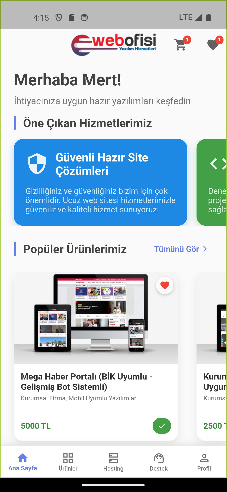<br>Home</td>
    <td align="center">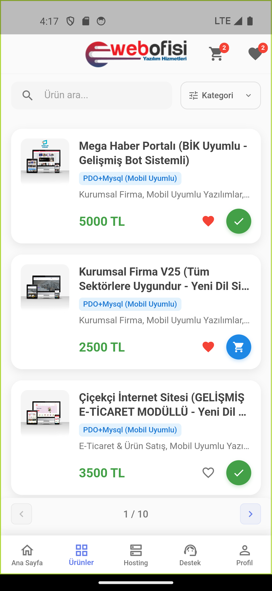<br>Product list</td>
    <td align="center">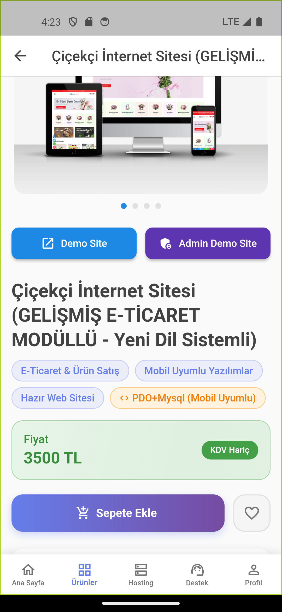<br>Product detail</td>
  </tr>
  <tr>
    <td align="center">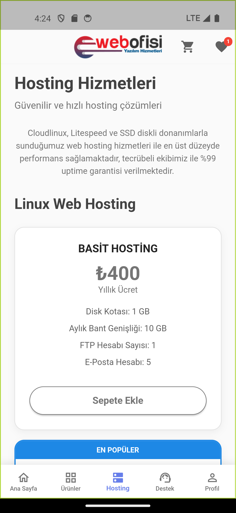<br>Hosting packages</td>
    <td align="center">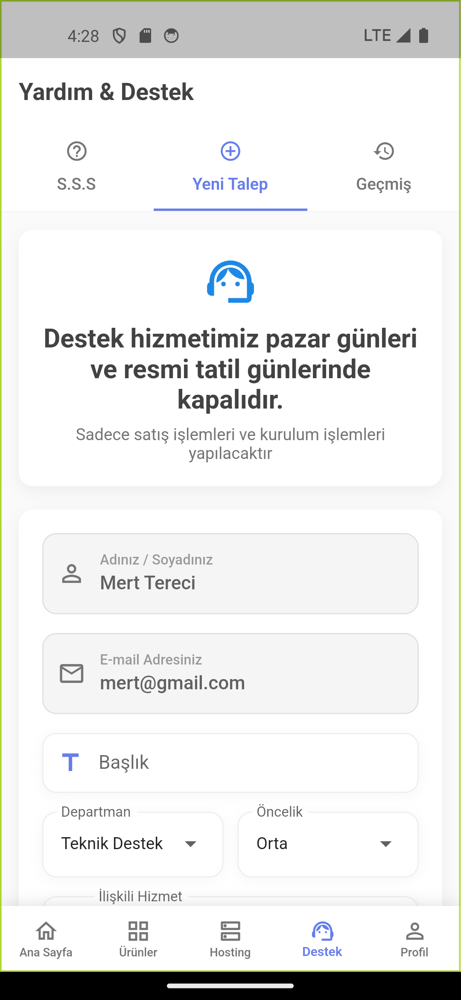<br>New support ticket</td>
    <td align="center">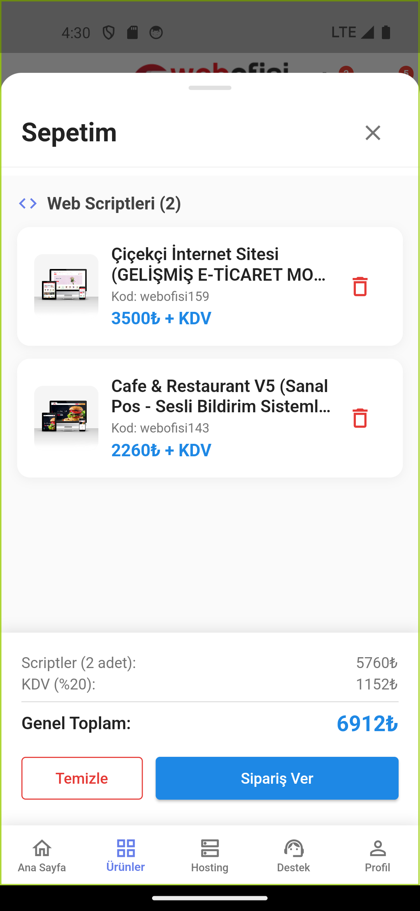<br>Cart</td>
    <td align="center">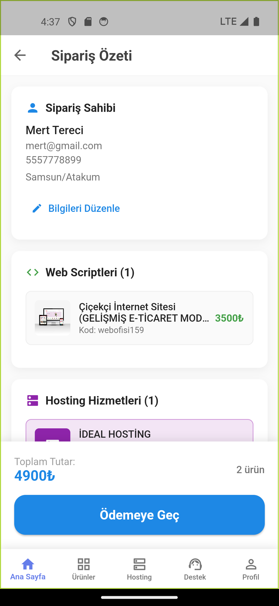<br>Checkout</td>
  </tr>
</table>

## Tech Stack

- Flutter and Dart
- Provider for state management
- json-server as a mock REST backend (db.json)
- XML parsing for the product catalog
- SharedPreferences for session persistence

## Features

### Accounts
- Login and multi-step registration with form validation and duplicate email check
- Token-based session that persists across app restarts
- Profile view and update

### Products
- 158 web scripts loaded from XML
- Search, category filtering and pagination
- Product detail page with image gallery and demo buttons
- Home page with promotional flash cards and a horizontal product strip

### Cart and Checkout
- Scripts and hosting packages in the same cart
- Hosting packages added through a dialog whose button activates once the required info is entered
- Cart keeps only product IDs in a Set, with an add/remove toggle
- Subtotal, 20% VAT and total shown separately
- Checkout flow that writes the order to the mock database (prototype, no real payment)

### Favorites
- Add and remove favorites per user through the mock API

### Support
- FAQ with 11 expandable questions, YouTube tutorial links and download links
- Support ticket form with auto-filled user info and department, priority and service selection
- Photo attachment from camera or gallery with compression (max width 1024, quality 80)
- Tickets are written to db.json

### Navigation
- 5-tab bottom navigation (Home, Products, Hosting, Support, Profile)
- Tab state preserved with IndexedStack
- Support section split into FAQ, New Request and Past Requests tabs

## Architecture

The app uses two data sources.

- **XML** for the product catalog
- **json-server** for users, orders, favorites, support tickets and the other tables
- **SharedPreferences** for session and cache

State is managed with Provider through a MultiProvider setup (ProductProvider, UserProvider, CartProvider, FavoritesProvider). Screens that need both cart and product data use Consumer2.

The models under `lib/models/tables` mirror the tables of the real backend database (members, scripts, categories, orders, credits, support, hosting orders, discount coupons, bank accounts, slider). The REST endpoints follow the same structure, so the move to the production API is designed to mainly require changing `baseUrl` in `MockApiService`.

```dart
// Development (Android emulator)
static const String baseUrl = 'http://10.0.2.2:3000';

// Production
static const String baseUrl = 'https://yourdomain.com/api';
```

### Project Structure

```
lib/
├── main.dart        # App entry and Provider setup
├── models/          # Data models, tables/ mirrors the backend schema
├── providers/       # Cart, product, favorites and user state
├── screens/         # Screens and the 5 main tabs
├── services/        # MockApiService, AuthService, ProductService (XML), FaqService
└── widgets/         # Reusable UI components
assets/data/         # Turkey city/district data and FAQ data
db.json              # json-server database
```

## Getting Started

Requires the Flutter SDK and Node.js.

```bash
# Install dependencies
flutter pub get

# Start the mock backend on port 3000
npx json-server db.json --port 3000

# Run the app
flutter run
```

The default `baseUrl` (10.0.2.2) reaches the host machine from an Android emulator. For other platforms or a physical device, it can be changed in `lib/services/mock_api_service.dart`.

## Known Limitations

- Attached photos are not stored yet. Only a placeholder text is saved with the ticket.
- Listing past tickets and updating ticket status are not implemented in the service layer yet.
- Payment is not integrated. Checkout is a simulation that writes the order to db.json.
- The backend is a mock. The production PHP API is not connected.

## Possible Next Steps

- Connecting to the production API
- Payment integration
- Order tracking using the existing orders table
- Product comparison
- Progressive web app support

## All Screenshots

<details>
<summary>Show all</summary>

<table>
  <tr>
    <td align="center">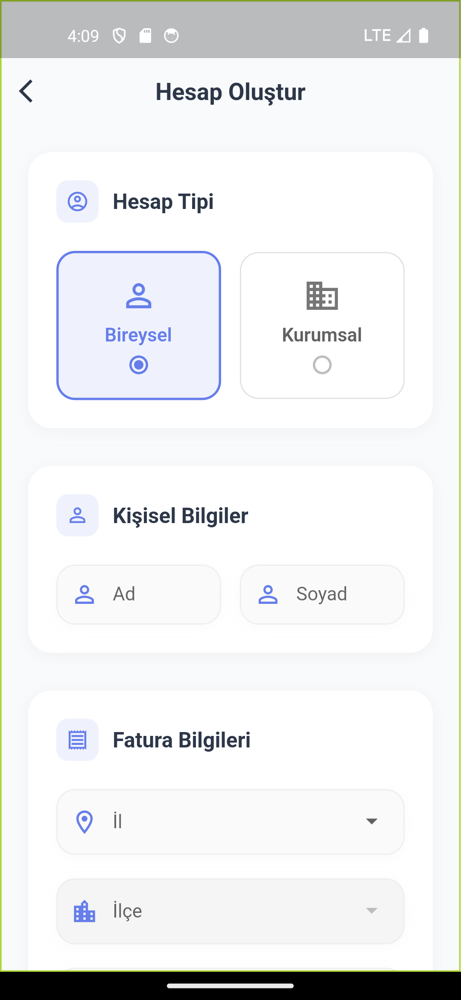<br>Register, step 1</td>
    <td align="center">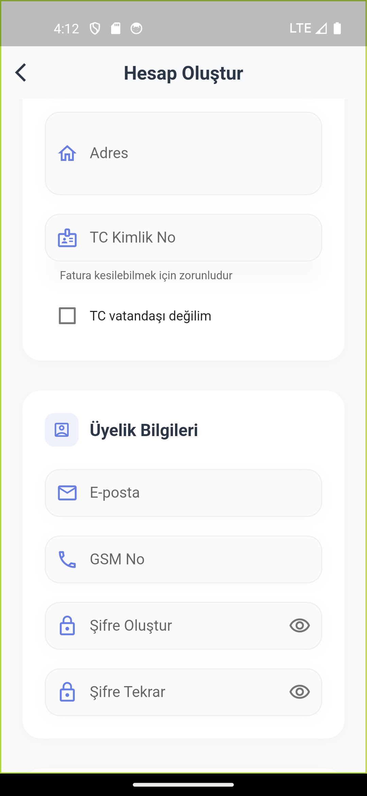<br>Register, step 2</td>
    <td align="center">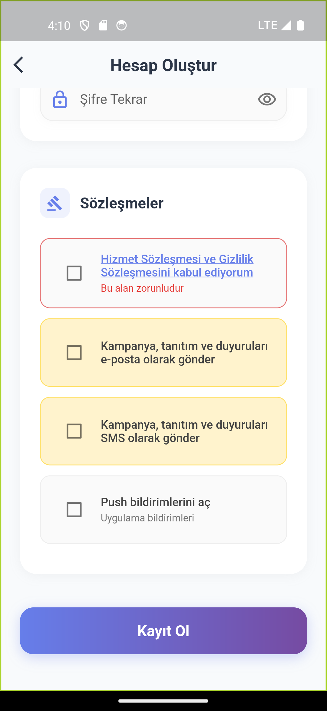<br>Register, step 3</td>
    <td align="center">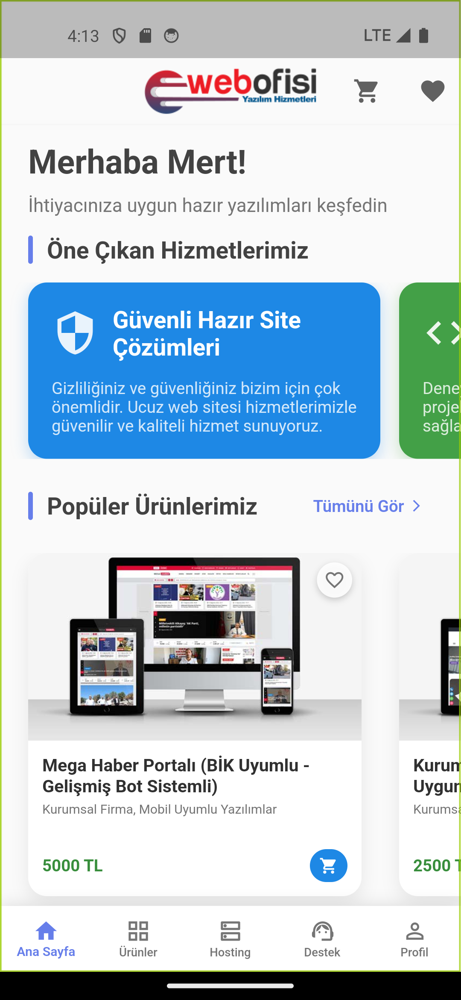<br>Home, empty</td>
  </tr>
  <tr>
    <td align="center">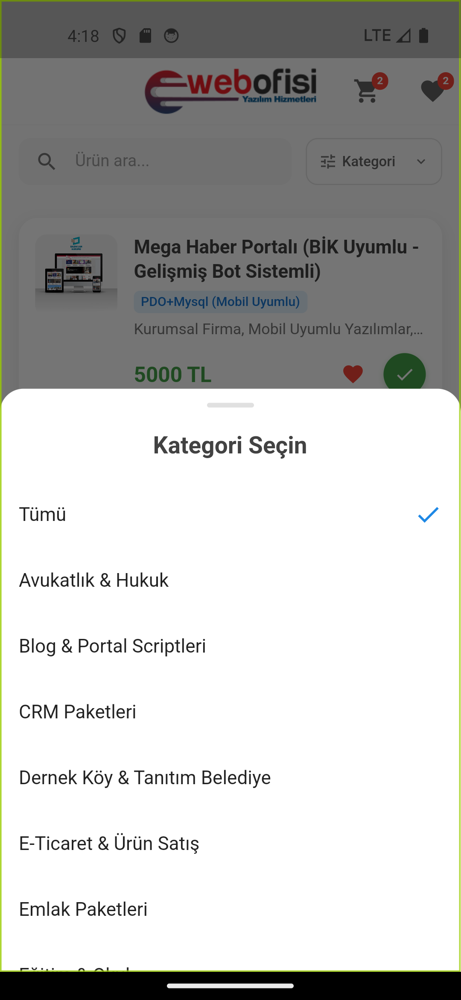<br>Category selector</td>
    <td align="center">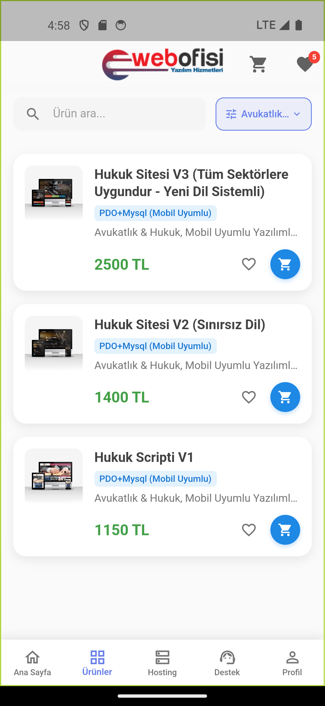<br>Filtered list</td>
    <td align="center">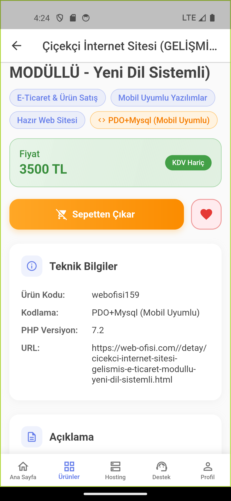<br>Product detail actions</td>
    <td align="center">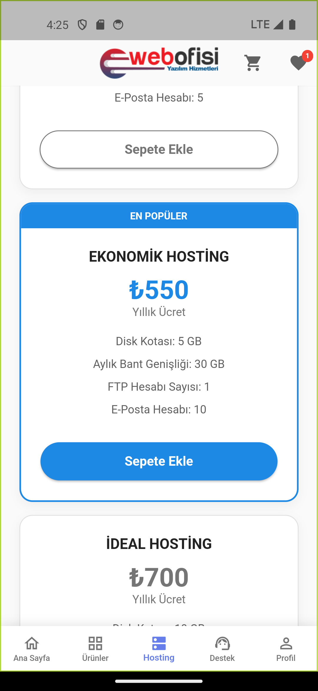<br>Hosting packages</td>
  </tr>
  <tr>
    <td align="center">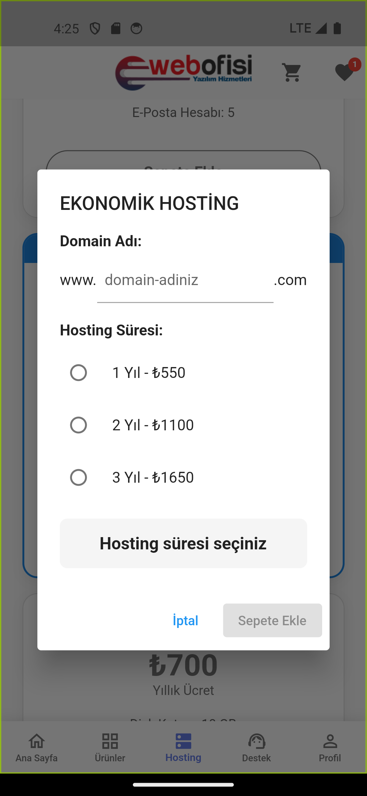<br>Add to cart dialog</td>
    <td align="center">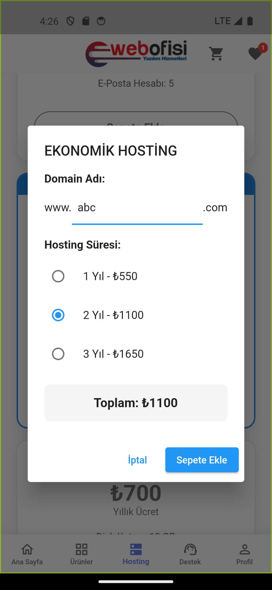<br>Dialog, button active</td>
    <td align="center">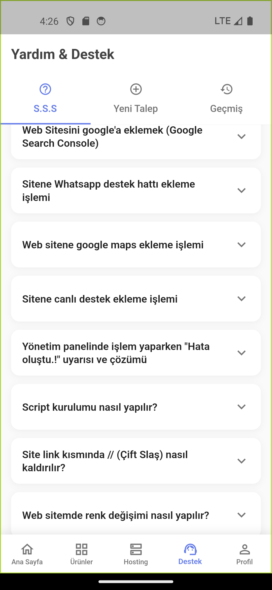<br>FAQ</td>
    <td align="center">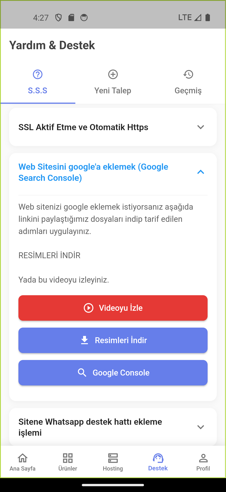<br>FAQ expanded</td>
  </tr>
  <tr>
    <td align="center">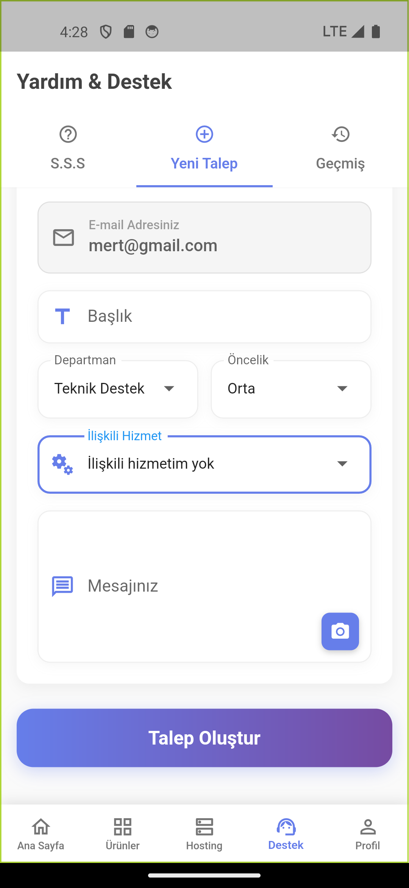<br>New ticket, continued</td>
    <td align="center">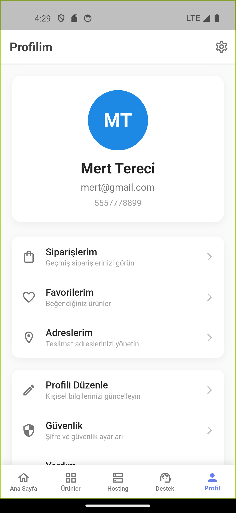<br>Profile</td>
    <td align="center">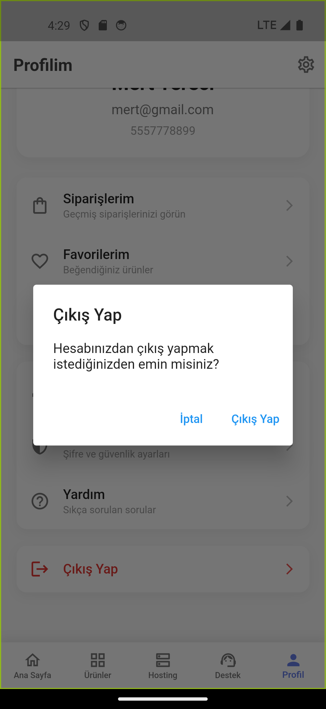<br>Logout dialog</td>
    <td align="center">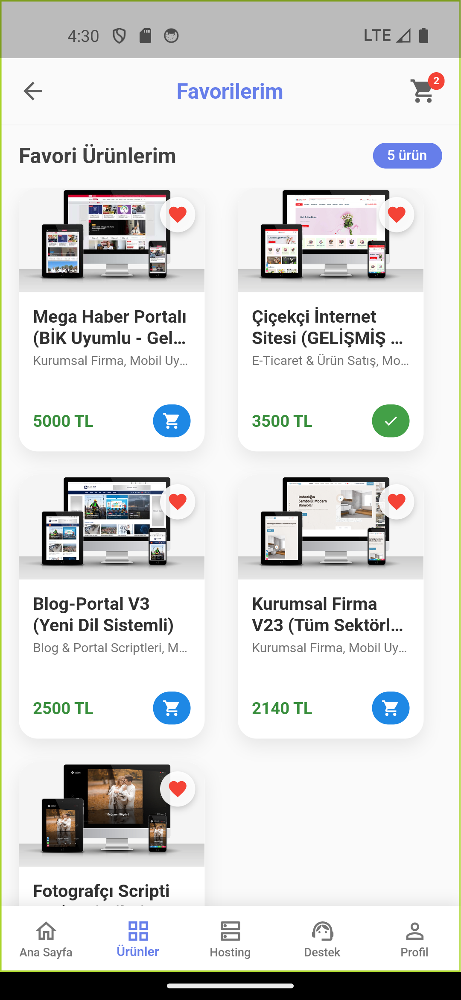<br>Favorites</td>
  </tr>
  <tr>
    <td align="center">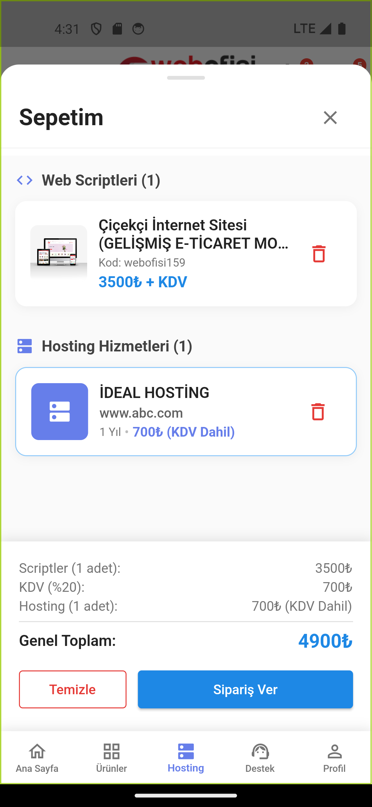<br>Cart, scripts only</td>
    <td align="center">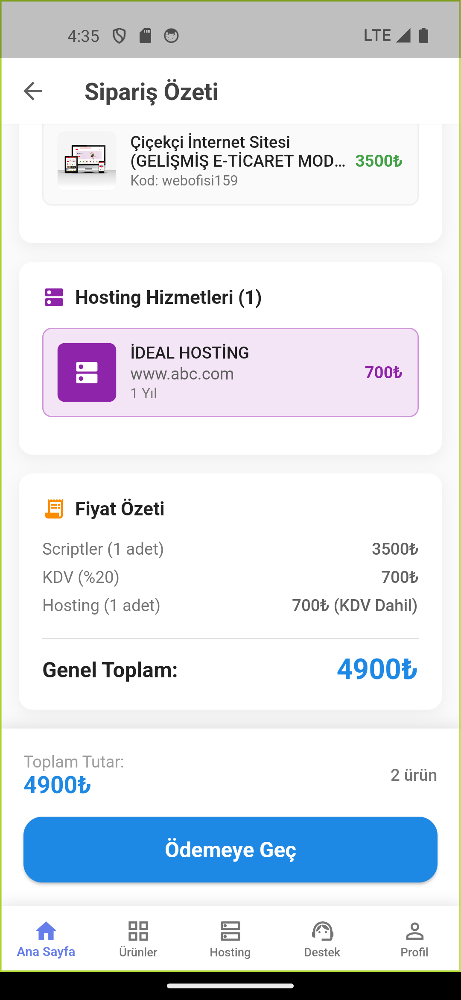<br>Checkout, continued</td>
    <td align="center">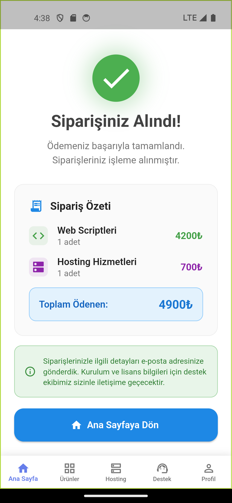<br>Order success</td>
    <td></td>
  </tr>
</table>

</details>

## Technical Details

<details>
<summary>Show technical details</summary>

### Full Directory Structure

```
assets/
├── data/
│   ├── cities.json                 # Turkey city/district data
│   └── faq_data.json               # FAQ data
├── launcher/
│   └── icon.png
└── logo/
    └── logo.png
lib/
├── main.dart                          # App entry and Provider setup
├── models/                            # Data models
│   ├── tables/                        # Database table models
│   │   ├── banka_hesaplari.dart
│   │   ├── destek_cevaplar.dart
│   │   ├── destek.dart
│   │   ├── hosting_siparisler.dart
│   │   ├── indirim_kuponlari.dart
│   │   ├── kategoriler.dart
│   │   ├── krediler.dart
│   │   ├── scriptler.dart
│   │   ├── siparisler.dart
│   │   ├── slider.dart
│   │   └── uyeler.dart
│   ├── product.dart                   # Main product model (XML data)
│   ├── hosting_cart_item.dart
│   ├── register_form_data.dart
│   ├── faq_item.dart
│   └── support_ticket_form_data.dart
├── providers/
│   ├── cart_provider.dart             # Cart state (minimal, ID-based)
│   ├── product_provider.dart
│   ├── favorites_provider.dart
│   └── user_provider.dart
├── screens/
│   ├── tabs/
│   │   ├── home_tab.dart
│   │   ├── products_tab.dart
│   │   ├── hosting_tab.dart
│   │   ├── support_tab.dart
│   │   └── profile_tab.dart
│   ├── auth_screen.dart                # Login screen
│   ├── scrollable_register_screen.dart # Multi-step registration
│   ├── cart_screen.dart                # Cart screen (modal)
│   ├── favorites_screen.dart
│   ├── home_screen.dart                # Home with app bar (cart and favorites)
│   ├── main_screen.dart                # Main screen (5-tab navigation)
│   ├── product_detail_screen.dart
│   ├── product_list_screen.dart        # Product list with app bar (cart and favorites)
│   ├── hosting_screen.dart
│   ├── support_screen.dart
│   └── profile_screen.dart
├── services/
│   ├── auth_service.dart              # Authentication via the mock API
│   ├── mock_api_service.dart          # HTTP service for json-server
│   ├── product_service.dart           # Product service (XML parser)
│   └── faq_service.dart               # FAQ data service
└── widgets/
    ├── cart_modal_widget.dart         # Reusable cart modal
    ├── custom_bottom_navbar.dart      # Custom 5-tab bottom navbar
    ├── flash_card_widget.dart         # Cards for promotions, news and announcements
    ├── product_card_v2.dart           # Compact product card (home)
    ├── product_details_widgets/
    │   ├── product_demo_buttons.dart
    │   ├── product_description_section.dart
    │   ├── product_detail_row.dart
    │   └── product_image_gallery.dart
    └── product_lists_widgets/
        ├── category_selector_modal.dart
        ├── compact_search_widget.dart # Compact search and category widget
        ├── error_widget.dart
        ├── loading_widget.dart
        ├── pagination_widget.dart
        └── product_card.dart          # Main product card (products page)
db.json                                # json-server database
```

### Service Layer

**MockApiService** (`lib/services/mock_api_service.dart`) handles all HTTP communication with json-server.

Support
- `createSupportTicket(ticketData)` creates a new ticket
- `getUserTickets(userId)` lists a user's tickets (planned)
- `updateTicketStatus(ticketId, status)` updates ticket status (planned)

Users
- `loginUser(email, password)`
- `registerUser(userData)`
- `updateUser(userId, userData)`

Scripts
- `getAllScripts()`
- `getScriptById(scriptId)`
- `getAllCategories()`

Favorites
- `getUserFavorites(userId)`
- `addToFavorites(userId, scriptId)`
- `removeFromFavorites(userId, scriptId)`

**FaqService** (`lib/services/faq_service.dart`) loads FAQ data from assets (`loadFaqItems()`) and searches it (`searchFaqItems()`), with error handling and type-safe parsing.

**AuthService** (`lib/services/auth_service.dart`) was first built on SharedPreferences and an asset JSON file, then moved to HTTP requests through MockApiService. It converts string IDs from the API to integers and handles request errors.

Login flow

```
userData = await MockApiService.loginUser(email, password)
→ TabloUyeler.fromJson(userData)
→ Token generation
→ SharedPreferences persistence
```

### db.json Structure

Designed to match the real database schema.

```
{
  "uyeler": [...],              // TabloUyeler
  "scriptler": [...],           // TabloScriptler
  "kategoriler": [...],         // TabloKategoriler
  "siparisler": [...],          // TabloSiparisler
  "favorites": [...],           // user_id, script_id, created_at
  "krediler": [...],            // TabloKrediler
  "destek": [...],              // TabloDestek
  "destek_cevaplar": [...],     // TabloDestekCevaplar
  "hosting_siparisler": [...],  // TabloHostingSiparisler
  "indirim_kuponlari": [...],   // TabloIndirimKuponlari
  "banka_hesaplari": [...],     // TabloBankaHesaplari
  "slider": [...]               // TabloSlider
}
```

### REST Endpoints (generated by json-server)

```
GET    /uyeler              # All users
POST   /uyeler              # New user
PUT    /uyeler/1            # Update user
DELETE /uyeler/1            # Delete user

GET    /favorites?user_id=1 # Query parameters
POST   /favorites           # Add favorite
DELETE /favorites/1         # Remove favorite
```

</details>
